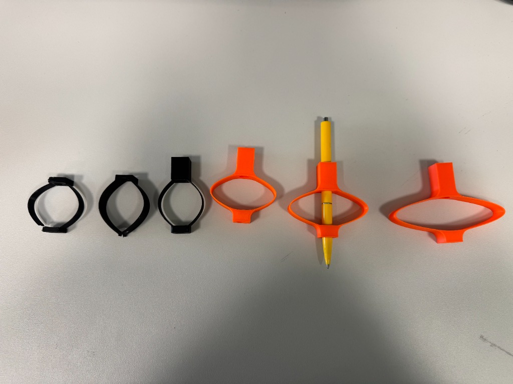
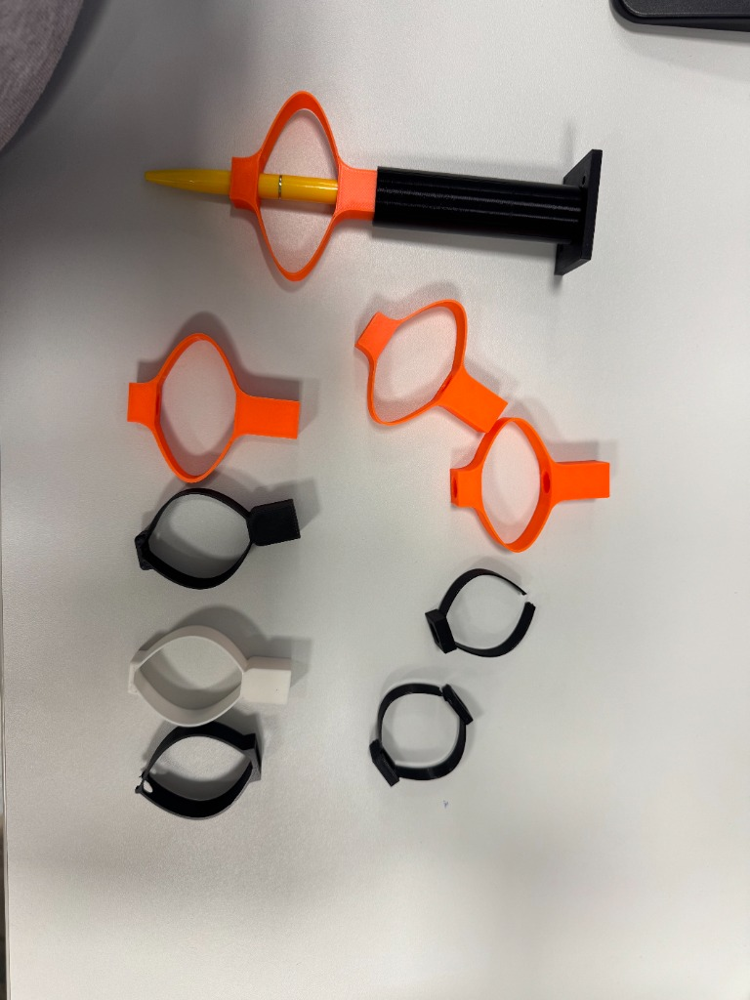

# Pastakahoidik

 ## Muudatused 

Jäik kinnitus → suurem liikumisruum → pastaka integreerimine → paindlikum pastakahoidik.

1. Kinnitus roboti käe külge muutub järjest suuremaks ja tugevamaks
- Esimesed kolm musta prototüüpi on suhteliselt väikesed ja kompaktsed rõngakujulised kinnitused.
- Erinevaid ülaosa ühenduskohad.
- Hilisemates oranžides variantides on kinnitusdetail juba selgemalt integreeritud hoidiku enda konstruktsiooni.
2. Lihtsast rõngast areneb piklik/ovaalne hoidik
- Esimestel prototüüpidel on ava peaaegu ümmargune.
- Hilisematel versioonidel muutub ava järjest ovaalsemaks ja piklikumaks.
- Viimastel variandil on väga suur horisontaalne ava, mis võimaldab pastakahoidikul rohkem liikuda (on vedrulisem).
3. Lisandub suurem liikumisvabadus
- Varasemad mustad prototüübid on pigem jäigad kinnitused.
- Oranžide variantide puhul on konstruktsioon kujundatud nii, et pastakas saab hoidikus rohkem liikuda.
- See on oluline, sest robotkäsi ise ei tee vajalike surve muutusi. Paindlik hoidik võimaldab pastakal neid liikumisi osaliselt kompenseerida.
4. Eesmärk: Pastakas paikneb hoidiku keskel
5. Konstruktsioon muutub suuremaks
 - Hoidiku üldine mõõt ja eriti rõnga/ava läbimõõt suurenevad.
- Suurem raam annab pastakale rohkem liikumisruumi ja võimaldab saavutada paindlikkust, ilma et kogu mehhanism peaks olema väga keeruline.
- Viimased prototüübid keskenduvad eelkõige paindlikkusele
6. Arenduse käigus on saadud aru, et roboti kirjutamisvõime jaoks ei ole vaja ainult tugevat kinnitust, vaid kontrollitud vabadus pastaka liikumiseks.

## Prototüüpide fotod

Järgnevatel fotodel on näha hoidikute eri versioonid: mustad jäigemad kinnitused, oranžid paindlikumad variandid ning pastakaga kokkupandud prototüüp.

