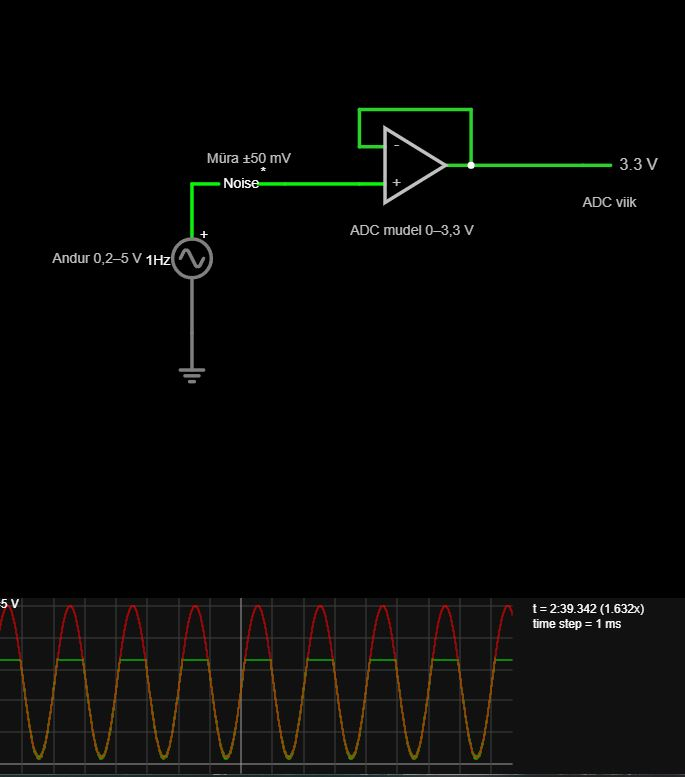
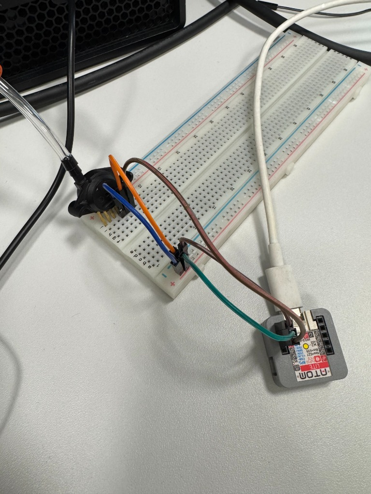

# Andmehõive

## 12.09.2026

**Kohal olid: Ats, Serafima, Ivan, Daniil**

1. Kaardistada, mis asju on vaja ja mis iga asi teeb.
   - Andur - Monolithic silicon absolute pressure sensor - MPX5700AP

   - AtomS3 - Miniature Programmable controller - Built around ESP32-S3

   - Maketeerimisplaat - Korduvkasutatav jootmisvaba alus alektroonikalülituste kiireks kokkupanemiseks ja testimiseks

   - Passiivkomplekt - Takistid, Kondensaatorid, Potentsiomeetrid, dioodid, valgusedioodid

   - Multimeeter - Mõõtmiseks and shit, et asju läbi ei põletaks

   - Ostsilloskoop - Elektrisignaalide reaalajas jälgimiseks, mõõtmiseks ja anaslüüsimiseks

   - 4 mm voolik - Mõeldud siis õhu/rõhu juhtimisele

   - T-liitmik - Õhu liikumiseks, kompressorist ühendub see andurisse ja selleni, mis päriselt tööd teeb

   - vooliku kork - peatada vool ühes voolikus
   - Iminapp - Täiturseade, mida kasutatakse objektide haaramiseks, tõstmiseks ja liigutamiseks vaakumi abil.

   - Polükarbonaatklaas - Klaas noh

2. Setup ühendus arvuti ja Roboti vahel:
   - Klooni Repo: https://github.com/KKallas/mg400-base
   - Setup Python environment (juhend README.md's)

3. Robot käitub kui ELETRILINE Energiaallikas !

4. How to Code this?
   - Ühenda DATA USB kaabliga arvuti külge.
   - Ava Thonny -> Run -> Configure Interpreter -> MicroController (ESP32) -> Vali õige MicroController (COM6 meie juhul).
   - Meil oli ka vaja updateida Microcontrollerit ennast, enne kui saime edukalt koodi seal jooksutada.
   - Mis on edasised sammud, kuidas saame Andurist infot ja mis selelga täpselt koodis vaja teha ?
     - Kuidas salvestada see Microcontrolleri peale, et päriselt ka töötaks pärast ja ühendada see olemasoleva ekosüsteemiga.
   - Vaja panna see kood samasse Giti, et saaks kutsuda API'd

5. Postman to Test API
   - API on olemas Gitis
   - Postman:
     - Text type to JSON; Muidu ei tööta

## 13.09.2026

**Kohal olid: Ats, Serafima, Ivan, Daniil**

1. Lisati kaardistuse märkmed Git-reposse.
2. Lisati esimesed AtomS3 ja arvuti vahelised rõhu mõõtmise ning pumba juhtimise skriptid.
   - Atom loeb anduri ADC väärtust ja saadab selle USB-seriali kaudu arvutisse.
   - Python teisendab näidu rõhuks, logib selle CSV-faili ning saadab pumba režiimi MG400 API-le.
   - Lisati kaks katsetusvarianti: käsitsi kirjutatud skriptid ja eraldi `scripts_ai` variant.
3. Täiendati käsitsi variandi logimist.
   - CSV-sse lisati ajatempel, pinge, arvutatud rõhk ja pumba režiim.
   - Pumbakontrollerisse lisati Escape-klahviga seiskamine.

Falstad skeem müraga:
[Link](https://www.falstad.com/circuit/circuitjs.html?ctz=DwYwlgTgBAZgvAIgAwKgFwM6KQOiUgRlTBEQNwCZ8KB2GgZiQA4KA2ATnZtRACNEArCigAHfgiGoAbhEGoAtpkEBTALQEiAPgBQUKMClQAHmVZIojACxQCZmzVap4yVAHdnRWLISf5AQyMpRAocS1ReMD8sBBDHKEhsPEIEAHodPWAAc2NTcysbO3p6OOcUNN19QxMfOwIHKApLczqS7DdnEu8zBQCg5DwBYm9cfCJyjNccmKb7VgskaxanNvH9Pyn823Mm5u7YRCYexHocegUwNqhMvzJ8O9T0-UnqzctrTYIKZZdV4GfjhY2T5QHZAr77H6PP5TUEaCgg-AFYSlB4VaHVWF2SzsOZbb5lKEAeRhOKRUAEbyR308GFIkLRRhh5kai1sDUs3AhwgwFx84LQykQAEEAHYAEwArtAkAAaCiAZAIBFAAGqojKM6p1awUAjaoQNOr41A8sj8wUIACyAB+IOsAI36+Sq34a4KkihUEFsj1nLnG3mfVAC4UAEQAwlB5BKxcoADZQJDy+gy+gqtX6V0IbG40kU+EEThGqAmvlB81C8NQKRgMAAa3TwAA9lBlCKDsaRKZvkZwZ2XI8MiIq5daXJVoOW5c+ty6YNfilGzpgClwBBNEA)

Skeem demonstreerib, et 0,2–5 V andurisignaal koos müraga ei mahu otse 0–3,3 V ADC sisendvahemikku ning üle 3,3 V olev signaal lõigatakse ära.

Skeemi kirjeldus:
- Andur 0,2–5 V. See on vahelduvpingeallikas, mis simuleerib päris anduri väljundit. Selle signaal muutub ajas vahemikus 0,2 V kuni 5 V.
- Müra ±50 mV. See on eraldi väike vahelduvpingeallikas, mis lisab andurisignaalile väikese juhusliku või kiiresti muutuva häire. Selle eesmärk on modelleerida päriselus tekkivat elektrilist müra. Näiteks kui andur annab parasjagu 2,00 V ja müra on +0,04 V, siis ADC mudelisse jõuab umbes 2,04 V. Kui müra on −0,03 V, jõuab sinna umbes 1,97 V. Müra amplituud on palju väiksem kui põhisignaalil, seega ta ei muuda kogu signaali olemust, vaid tekitab selle ümber väikese "värina".
- ADC mudel 0–3,3 V. ADC tähendab Analog-to-Digital Converter ehk analoog-digitaalmuundurit. Selle ülesanne päris mikrokontrolleris oleks analoogpinge digitaalseks väärtuseks teisendada. Antud skeemis kasutatakse op-võimendit pingejärgurina, et näidata ADC sisendi lubatud pingevahemikku. Op-võimendi väljund on piiratud vahemikku 0–3,3 V.
- Tagasiside op-võimendil. Op-võimendi väljund on ühendatud tagasi tema negatiivsele − sisendile. See tekitab negatiivse tagasiside ja muudab op-võimendi pingejärguriks.
- ADC viik. See on lihtsalt skeemi väljundpunkt, mis tähistab mikrokontrolleri ADC sisendviiku. Ehk see on pinge, mida ADC "näeks".
- Scope. Scope ehk ostsilloskoop kuvab ADC viigu pinge ajas. Selle pealt peaks olema näha kaks asja:
   - müra tõttu ei ole joon täiesti sile;
   - kui andurisignaal läheb üle 3,3 V, lõigatakse laine ülemine osa ära.

## 03.10.2026

1. Täiendati käsitsi variandi pumbakontrollerit.
   - Seriali pordiks muudeti COM5 (115200 baud).
   - Mõõteread kirjutatakse `log.csv` faili ja prinditakse samal kujul ka konsooli.
   - Escape-klahvi või Ctrl-C vajutamisel ning tavalisel juhtsilmusest väljumisel küsitakse API-lt pumba väljalülitamist.
2. Eemaldati vana `orchestrator.py`.
   - `pump_controller.py` saadab nüüd `controller.py` sisu ise AtomS3-le; eraldi `mpremote`-i protsessi ei käivitata.
   - Kasutada tuleb õiget seriali porti ning vältida sama pordi samaaegset avamist teise programmi poolt.

   Anduri, maketeerimisplaadi ja AtomS3 ühenduse foto:

## 24.10.2026

- **Failide korrastamine (`d4fc432`).** Käsitsi kirjutatud skriptid koondati `src/` alla, vanad `scripts_ai` prototüübid eemaldati ning lisati käivitamisjuhised. 03.10 mõõtelogid paigutati `data/` alla; varasemad 10 Hz logid säilitati võrdluseks. Lisati mõlema labori ülesandetekstid ja täiendati `Dokumentatsioon.md` faili.
- **100 Hz logimine ja pumbajuhtimine (`b6718f6`).** Atomi mõõtesamm muudeti 10 ms peale. Logisse lisati ADC kood, pinge, atmosfääri suhtes rõhk ja pumba olek. Lisati `suck`, `blow` ja `off` režiimid, kestuse ja käivituste arvu piirid, logifaili nime valik ning olemasoleva faili ülekirjutamise keeld. Pumba riba on 15/30 kPa, minimaalne seisuaeg 1 s, käivituste piir 10 minutis ja andmete puudumise ajapiir 0,5 s. Atmosfääri lähteväärtus on 96,2 kPa absoluutrõhku.
- **Logija ja ADC kontroll (`b6718f6`, `eff19ce`).** `l1_10s.csv` kirjelduses on 998 mõõterida 9,96 s jooksul ehk ligikaudu 100,2 Hz. ADC näit 0,818 V erines multimeetri 0,833 V näidust 0,015 V ehk 1,8%. Mõõdetud ADC samm oli ligikaudu 0,819 mV ehk 127 Pa.
- **Müraanalüüs (`b6718f6`, `a51275d`).** Lisati `notebooks/noise_analysis.py`, müra CSV-d ja `Docs/l1_spectrum.png`. Servod väljas mõõtmine korrati toorkanalis. Andmete kokkuvõtte järgi on müra pumba seistes 8,7 LSB ja töötades 12,0 LSB; pumbaga tekivad tipud 19,5 ja 39,1 Hz juures. Servode väljalülitamine müra märgatavalt ei vähendanud; 10 Hz tipu allikas jäi kontrollimata.
- **Napp õhus (`1a06f85`).** `l1_hold_air.csv`: 60,0 s, 6004 toorkanali rida, üks käivitus, pump töötas ligikaudu 59 s ning rõhk oli umbes −12,8 kPa. Lühitsüklit ei tekkinud, kuid vaakumi mittesaavutamisel töötamise ajalimiiti veel ei ole.
- **Napp klaasil (`470234e`, sõnaparandus `a93f543`).** `l1_hold_glass.csv`: üks käivitus 60 s jooksul, pumba tööaeg 0,10 s ja leke ligikaudu 0,019 kPa/s. Madalaim rõhk oli −48,6 kPa. README-s toodud umbes 20 minuti hoideaeg on lekkekiirusest arvutatud hinnang, mitte 20-minutiline katse.
- **Puhumine (`abfd373`).** `l1_blow_glass.csv`: 10 käivitust 17,7 s jooksul, mille järel käivituste piir takistas uusi käivitusi. Seisuaeg oli vähemalt ligikaudu 1 s. Järeldus: klaasi vabastamiseks sobib ühekordne puhumisimpulss, mitte pidev rõhu hoidmine.
- **USB katkestus (`4de4208`).** `l1_usb_pull.csv` ja katsekirjelduse järgi saadeti ning kinnitati pumba `off` alla 0,1 s pärast viimast mõõterida. See ei kata arvuti kokkujooksmist või protsessi sundlõpetamist; roboti või pumbakasti sõltumatu ajapiir jääb eraldi küsimuseks.
- **Suletud liin (`b69c506`).** `l1_hold_sealed.csv`: üks käivitus 60 s jooksul, pumba tööaeg 0,10 s ning leke ligikaudu 0,025 kPa/s. `data/README.md` koondab klaasil, õhus ja suletud liiniga katsed ning põhjendab riba ja käivituste piiride valikut.
- **Ühiskatse materjalid (`cd4b5b8`, `88e4d1b`).** Kausta `ÜldResult/Lab1&2/` lisati Atomi pildiedastuse ja MG400 tähtede joonistamise videod ning tulemuste kirjeldus. Kirjelduse järgi katsetati ka tähe H saatmist otse seadmest. [Ühiskatse kirjeldus](../../../ÜldResult/Lab1&2/Kirjeldus.md).

## 25.10.2026 — videokatsete filmimine

- Filmiti Atomi kasutamist tähe sisendina ja valitud tähe H joonistamist robotiga. [Tähtede joonistamise video](../../../ÜldResult/Lab1&2/1_Tähtede_joonistamine/tahtede_joonistamine.mp4).
- Filmiti vaakumhaaratsi ja pumbajuhtimise kasutamist eseme haaramisel, teisaldamisel ning vabastamisel. [Esemete teisaldamise video](../../../ÜldResult/Lab1&2/4_Esemete_teisaldamine/esemete_teisaldamine.mp4).
