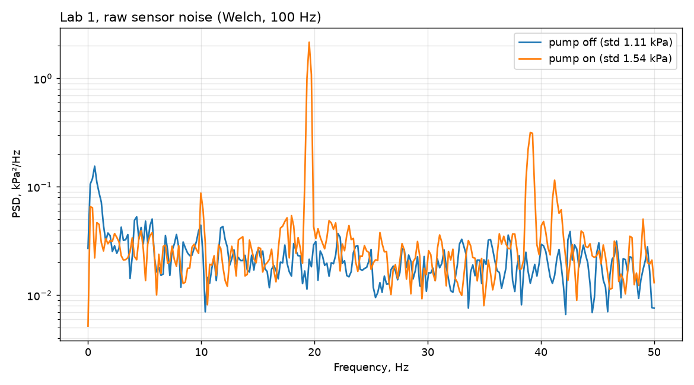

# Labor 1 — logid

Logid on tehtud skriptiga `../src/pump_controller.py`. Andur on otse ADC küljes (toores signaal).

Veerud:

| Veerg | Mis see on |
| :--- | :--- |
| `time_ms` | arvuti aeg, Unix millisekundites |
| `volts` | anduri pinge ADC viigul, V |
| `pressure_kpa` | rõhk, kPa **absoluutne** (atmosfäär ≈ 99 kPa) |
| `compressor` | pumba olek: `suck`, `off` või `None` (alguses) |

## Failid

| Fail | Kuupäev | Ridu | Kestus | Sagedus | Pinge |
| :--- | :--- | :--- | :--- | :--- | :--- |
| `log_2026-10-03_1.csv` | 03.10.2026 12:24 | 397 | 39,7 s | 10 Hz | 0,474–0,852 V |
| `log_2026-10-03_2.csv` | 03.10.2026 12:41 | 271 | 27,0 s | 10 Hz | 0,517–0,858 V |

Mõlemas on näha imemine (`suck`) ja seis (`off`).

## Numbrid: `log_2026-10-03_1.csv`

Skript: vana `pump_controller.py`, riba 98 kPa sisse / 70 kPa välja (absoluutne). Arvutatud logist.

| Mis | Number |
| :--- | :--- |
| Ridu / kestus | 397 rida / 39,7 s |
| Samm ridade vahel | keskmiselt 100 ms (75–113 ms) → 10 Hz |
| Atmosfäär (esimene rida) | 99,4 kPa (0,839 V) |
| Väikseim rõhk | 42,6 kPa abs = −56,8 kPa atmosfääri suhtes |
| Käivitusi | 11 korda 39,7 s jooksul = **16,6 käivitust minutis** |
| Pumba tööaeg | 0,2–5,3 s, keskmiselt 1,4 s |
| Seisuaeg | 0,2–6,2 s, keskmiselt 2,2 s |
| Töötsükkel | ~40 % |
| Sisselülitus (rõhk enne `suck`) | 98,9–101,4 kPa abs |
| Väljalülitus (rõhk enne `off`) | 42,6–69,5 kPa abs |
| Pinge pumba töö ajal | ~0,749 V ≈ 85,5 kPa abs |
| Müra, pump seisab (25 rida, 0,573 V) | std 7,7 mV ≈ **9,6 LSB** ≈ 1,2 kPa |
| Müra, pump töötab (~0,749 V) | std 13,1 mV ≈ **16,2 LSB** |
| Üks ADC samm (arvutatud) | 3,3 V / 4096 = 0,81 mV → 0,81 / 6,43 mV/kPa ≈ **125 Pa** |

Mida see näitab:
- **Pump lühitsüklib**: 16,6 käivitust minutis, seisuaeg mõnikord ainult 0,2–0,4 s. Seisuaja alampiiri ei olnud.
- **Väljalülitus hüppab 42–70 kPa vahel**, kuigi piir on 70 kPa. Rõhk langeb ühe rea (100 ms) jooksul ~85 → ~50 kPa, 10 Hz on selleks liiga aeglane.
- **Rõhk tõuseb pärast väljalülitust tagasi atmosfääri** 0,2–6 s jooksul: haare lekib.
- Müra pumbaga on umbes 1,7 korda suurem kui ilma pumbata.

**Tähelepanu:** logid on 10 Hz, sest `controller.py` ootab iga rea vahel 100 ms. Ülesanne küsib 100 Hz.

## Uus formaat (alates 24.10.2026)

Need kaks vana logi on tehtud vana skriptiga. Uued logid on 100 Hz ja veergudega `t_ms, adc, volts, p_kpa, pump`, kus `p_kpa` on rõhk **atmosfääri suhtes** ja `pump` on 1/0. Vaata [`../src/README.md`](../src/README.md).

## Mõõtmised 24.10.2026 (100 Hz, napp robotil õhus)

Tehtud skriptiga `Lab2/src/pump_controller.py`, sest Atom loeb seal mõlemat viiku. Labori 1 andmed on read `config = raw` (GPIO33, andur otse ADC-s, vahel ei ole midagi). Analüüs: [`../notebooks/noise_analysis.py`](../notebooks/noise_analysis.py).

| Fail | Mis tehti | Napp | Pump |
| :--- | :--- | :--- | :--- |
| `l1_10s.csv` | logija kontroll, 10 s | õhus | seisab |
| `l1_noise_off.csv` | müra, 30 s | õhus | seisab |
| `l1_noise_on.csv` | müra, 30 s | õhus | töötab (käivitub 1 s pärast) |
| `l1_noise_servo_off.csv` | müra, servod välja, 30 s | õhus | seisab |

### Logija kontroll

| Mis | Number | Nõue |
| :--- | :--- | :--- |
| Ridu 10 s kohta | 998 rida 9,96 s jooksul = 100,2 Hz → **1002 rida / 10 s** | 1000 ± 5 ✅ |
| Pinge atmosfääris (ADC) | **0,818 V** | — |
| Pinge atmosfääris (multimeeter, Vout) | **0,833 V** | — |
| Vahe ADC vs multimeeter | 0,015 V = **1,8 %** (ADC näitab vähem) | ≤ 2 % ✅ |
| Atmosfäär | 0,818–0,819 V → **96,2 kPa abs** (andmelehe valem, toide 5,0 V) | `ATM_KPA = 96.2` skriptides |

Multimeetri järgi on atmosfäär 0,833 V → 98,5 kPa abs. Skriptid kasutavad ADC numbrit (96,2), sest pump otsustab ADC lugemi järgi ja nii on atmosfäär 0 kPa.

### Üks ADC samm

| Mis | Number |
| :--- | :--- |
| Mõõdetud (pinge vs ADC kood kõigist logidest) | 0,819 mV sammu kohta (ideaal 3,3 V / 4096 = 0,806 mV) |
| Anduri tundlikkus | 5 V · 0,0012858 = 6,43 mV/kPa |
| **Pa ühe ADC sammu kohta** | 0,819 / 6,43 ≈ **127 Pa** (arvutatud 125 Pa) |

### Müra

Pumbaga logist on võetud ainult read, kus pump töötab, ilma 2 s üleminekuta.

| Olukord | Ridu | Keskmine | Müra (std) | Müra kPa | Tipud spektris |
| :--- | :--- | :--- | :--- | :--- | :--- |
| Pump seisab | 2795 | 0,819 V | **8,7 LSB** | 1,11 kPa | 0,6 Hz (aeglane triiv) |
| Pump töötab (napp õhus) | 2701 | 0,735 V (≈ −13 kPa) | **12,0 LSB** | 1,54 kPa | **19,5 Hz**, **39,1 Hz**, väike 10 Hz |
| Pump seisab, MG400 servod väljas | 2795 | 0,819 V | **8,7 LSB** | 1,10 kPa | 10 Hz |

Tipu kõrgus müra põhja (mediaani) suhtes:

| Sagedus | Pump seisab | Pump töötab | Servod väljas |
| :--- | :--- | :--- | :--- |
| 0,4 Hz | 5,8× | 2,6× | 4,4× |
| 10 Hz | 2,1× | 3,5× | 7,6× |
| 19,5 Hz | 1,0× | **86×** | 0,9× |
| 39,1 Hz | 0,6× | **12,6×** | 0,6× |
| 49,8 Hz | 0,4× | 0,8× | 1,6× |

Spekter: 

Tippude nimed:
- **19,5 Hz — pumba mootor.** Kontrollitud allika väljalülitamisega: pump seisab → tippu ei ole.
- **39,1 Hz — sama mootori 2. harmooniline** (2 × 19,5 Hz). Kaob koos pumbaga.
- **50 Hz (võrk) ei ole näha.** 100 Hz juures on 50 Hz täpselt Nyquisti sagedus, nii et see läheb spektri serva või 0 Hz peale. Selle nägemiseks on vaja suuremat sagedust või ostsilloskoobi FFT-d.
- **MG400 servod — mõõdetavat mõju ei ole.** Kontrollitud allika väljalülitamisega (`l1_noise_servo_off.csv`, Disable): müra 8,71 LSB servod väljas vs 8,69 LSB servod sees, ükski tipp ei kadunud.
- **10 Hz — allikas teadmata.** Ei ole pump ega servod: servod väljas oli ta isegi kõrgem (7,6× vs 2,1×). Kandidaat: USB / arvuti (logija prindib iga 10. rea ehk 10 korda sekundis). Kontrollimata.
- **0,4–0,6 Hz — aeglane triiv** (temperatuur, toide), mitte võnkumine.

**Kaks allikat on kontrollitud väljalülitamisega:** pumba mootor (tipp kaob) ja MG400 servod (muutust ei ole).

Võrdlus 03.10 logiga (10 Hz): siis 9,6 LSB pump seisab, 16,2 LSB pump töötab. Nüüd 100 Hz juures 8,7 ja 12,0 LSB.

## Oma kast: napp õhus (`l1_hold_air.csv`)

Käsk: `python pump_controller.py suck raw t=60 ../../Lab1/data/l1_hold_air.csv` (Lab2/src). Napp robotil õhus, mitte midagi peal. Riba: pump käima nõrgemal kui −15 kPa, seisma −30 kPa juures, seisuaja alampiir 1 s, kuni 10 käivitust minutis.

| Mis | Number |
| :--- | :--- |
| Kestus / sagedus | 60,0 s, 6004 rida, 100,1 Hz |
| Rõhk enne pumpa | 0,15 kPa (atmosfäär ≈ 0 ✅) |
| Pump käivitus | 0,95 s pärast (seisuaja alampiir 1 s) |
| **Käivitusi** | **1 kord 60 s jooksul = 1 käivitus minutis** |
| Pumba tööaeg | 59,0 s (98 %) |
| Rõhk pumba töö ajal | **−12,8 kPa** (−17,7 … −7,4), müra 1,52 kPa / 11,5 LSB |

Mida see näitab:
- **Lühitsüklit ei ole.** Napp õhus ei jõua kunagi −30 kPa-ni, nii et pump töötab pidevalt ja ei käivitu iga sekund. Ülesande nõue "napp õhus ei tohi lühitsüklitesse minna" on täidetud.
- **Õhus annab pump ainult umbes −13 kPa.** See on napi lahtise ava kaudu vooluga saavutatud rõhk.
- Puudus: pump töötab õhus lõputult. Kui tahta pumpa säästa, võiks lisada piiri "kui X s jooksul −30 kPa ei tule, pump seisma". Praegu seda ei ole.

Lisaks (Labori 2 jaoks): op-ampi kanal näitas samas logis −12,5 kPa, müra **1,03 kPa** (toores 1,52 kPa). `GAIN`/`OFFSET` on vanad, nii et see on esialgne number.

## Oma kast: napp klaasil (`l1_hold_glass.csv`)

Käsk: `python pump_controller.py suck raw t=60 ../../Lab1/data/l1_hold_glass.csv` (Lab2/src). Klaas napil tihedalt. Riba sama: käima −15 kPa, seisma −30 kPa.

| Mis | Number |
| :--- | :--- |
| Rõhk enne pumpa | 1,0 kPa |
| Pump käivitus | 0,94 s pärast |
| **Pumba tööaeg** | **0,10 s** (üks rida 10 ms kohta → 10 rida) |
| Rõhk väljalülitamisel | −33,1 kPa (piir −30, ületus ühe rea jooksul) |
| Kõige madalam rõhk | **−48,6 kPa** 0,05 s pärast väljalülitust (pump veereb edasi) |
| Rõhk hoidmisel | −38,5 kPa (1 s pärast) → −37,2 kPa (60 s lõpus) |
| **Leke** | **0,019 kPa/s** |
| **Käivitusi** | **1 kord 60 s jooksul** |
| Müra hoidmisel (viimased 10 s) | 1,25 kPa |

Mida see näitab:
- **Haare on tihe.** 0,019 kPa/s juures jõuab rõhk −37 → −15 kPa umbes (37 − 15) / 0,019 ≈ 1170 s ≈ **20 minutiga**. Nii kaua pump ei käivitu.
- **Pump on klaasil väga kiire:** −30 kPa tuleb 0,1 s jooksul. Riba −15 / −30 on klaasi jaoks piisavalt lai.
- **Pärast väljalülitust langeb rõhk veel 15 kPa** (−33 → −48,6). Seepärast hoitakse tegelikult −38 kPa, mitte −30.

Lisaks (Labori 2 jaoks): samas logis op-ampi kanal: leke 0,016 kPa/s, müra hoidmisel **0,42 kPa** (toores 1,25 kPa) → umbes 3 korda väiksem müra.

## Oma kast: puhumine klaasi vastu (`l1_blow_glass.csv`)

Käsk: `python pump_controller.py blow raw t=30 ../../Lab1/data/l1_blow_glass.csv` (Lab2/src). Napp klaasil. Riba: käima nõrgemal kui +15 kPa, seisma +30 kPa juures.

| Mis | Number |
| :--- | :--- |
| Rõhk alguses | 0,8 kPa (vaakum oli juba läinud) |
| Kõige kõrgem rõhk | **+51,4 kPa** |
| Pumba tööaeg ühe käivituse kohta | 0,08–1,84 s |
| Rõhk pärast väljalülitust | +30 → ~0 kPa umbes **1 s** jooksul |
| **Käivitusi** | **10 korda 17,7 s jooksul**, siis käivituste piir (10 / min) peatas pumba |
| Seisuaeg käivituste vahel | 1,01 s (= seisuaja alampiir) |
| Pumba töötsükkel | 5,4 s / 30 s = 18 % |

Mida see näitab:
- **Puhumine ei hoia rõhku**, sest klaas tõuseb napilt ja õhk läheb välja. Rõhk on +30 kPa ainult hetke.
- **Ilma piirideta oleks see lühitsükkel.** Seisuaja alampiir (1 s) ja käivituste piir (10 / min) töötasid: pärast 10. käivitust pump enam ei käivitunud.
- **Järeldus `pump_control.md` jaoks:** puhumine ei ole "hoidmine", vaid ühekordne impulss klaasi lahti laskmiseks. Parem loogika: puhu kuni +30 kPa või kuni X s, siis `off`, ja ära käivita uuesti.

## USB välja = pump välja (`l1_usb_pull.csv`)

Käsk: `python pump_controller.py suck raw t=60 ../../Lab1/data/l1_usb_pull.csv` (Lab2/src). Napp õhus, et pump töötaks pidevalt. Töö ajal tõmmati Atomi USB välja.

| Mis | Number |
| :--- | :--- |
| Pump käivitus | 0,95 s pärast |
| Pump töötas enne USB väljatõmbamist | 2,88 s (rõhk −12,7 kPa) |
| Viimane rida Atomist | 17:12:06,970 |
| `off` saadetud ja API kinnitas (`pump_mode: off`, DO = 0) | enne 17:12:07,065 → **alla 0,1 s** |

Mis juhtus: seriali lugemine andis vea (`SerialException`), programm läks `finally` plokki ja saatis pumbale `off`. Kui USB kaabel on terve, aga Atom vaikib, lülitab pumba välja 0,5 s ajapiir (`TIMEOUT_S`).

✅ **Nõue "USB välja, pump välja" on täidetud.**

Mida see ei kata: kui **arvuti ise** kukub või Pythoni protsess tapetakse, jääb MG400 DO liin üles ja pump töötab edasi. Selle vastu peaks ajapiir olema roboti või pumbakasti poolel.

## Oma kast: suletud liin (`l1_hold_sealed.csv`)

Käsk: `python pump_controller.py suck raw t=60 ../../Lab1/data/l1_hold_sealed.csv` (Lab2/src). Liin suletud (korgi asemel). Riba sama: käima −15 kPa, seisma −30 kPa.

| Mis | Number |
| :--- | :--- |
| Rõhk enne pumpa | 0,2 kPa |
| Pumba tööaeg | **0,10 s** |
| Rõhk väljalülitamisel | −32,4 kPa |
| Kõige madalam rõhk | −44,7 kPa |
| Rõhk hoidmisel | −36,0 kPa (1 s pärast) → −34,6 kPa (60 s lõpus) |
| **Leke** | **0,025 kPa/s** |
| **Käivitusi** | **1 kord 60 s jooksul** |
| Müra hoidmisel | 1,30 kPa (op-amp 0,45 kPa) |

## Kokkuvõte: kolm olukorda (riba −15 / −30 kPa, seisuaja alampiir 1 s, max 10 käivitust / min)

| Olukord | Fail | Rõhk hoidmisel | Leke | Pumba tööaeg | Käivitusi minutis | Lühitsükkel? |
| :--- | :--- | :--- | :--- | :--- | :--- | :--- |
| Napp klaasil | `l1_hold_glass.csv` | −38 kPa | 0,019 kPa/s | 0,10 s | 1 | ei |
| Napp õhus | `l1_hold_air.csv` | −13 kPa (pump töötab) | — | 59 s (98 %) | 1 | ei |
| Suletud liin | `l1_hold_sealed.csv` | −35 kPa | 0,025 kPa/s | 0,10 s | 1 | ei |
| Puhumine klaasi vastu | `l1_blow_glass.csv` | ei hoia (+30 → 0 ~1 s) | — | 0,1–1,8 s | 10 (piir) | **jah**, piir peatas |

Sealt tulevad `pump_control.md` numbrid:
- **Riba:** −15 / −30 kPa. Müra on 1,1–1,5 kPa, riba laius 15 kPa ≈ **10–14 korda müra kohal**.
- **Seisuaja alampiir:** 1 s. Imemisel ei olnud seda vaja (leke on aeglane), puhumisel just see piiras käivitusi.
- **Käivituste ülempiir:** 10 minutis. Imemisel 1 / min, puhumisel jõudis piirini.
- **Rõhk napp klaasil −38 kPa, napp õhus −13 kPa.** Nende vahe on 25 kPa, nii et haaret on lihtne ära tunda.
