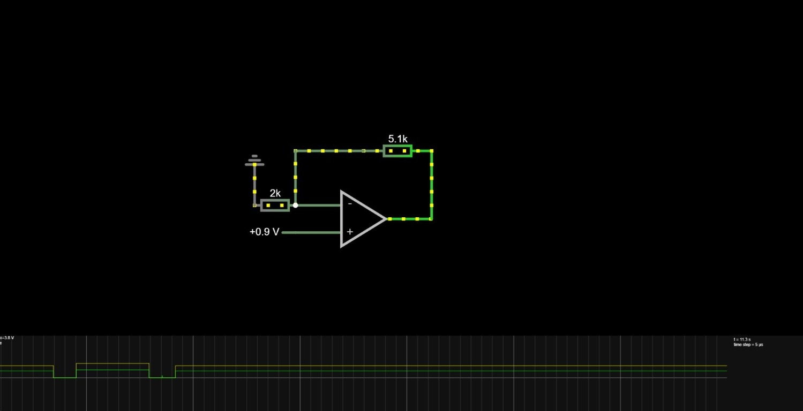
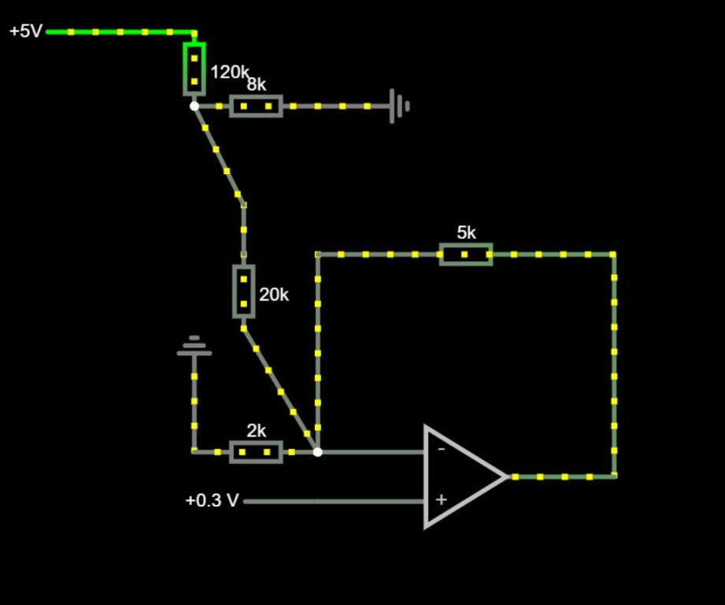
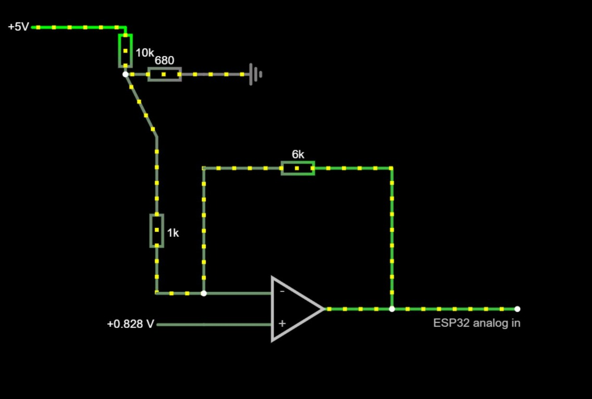
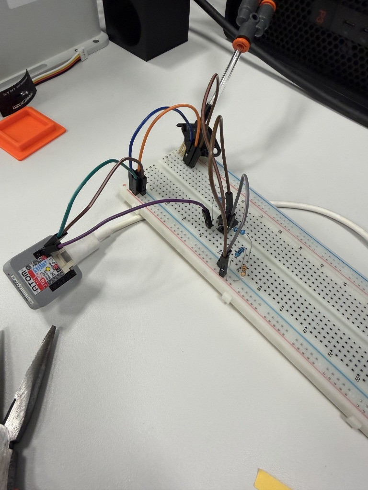

# Andmehõive Lab2

## 03.10.2026
Skeem 1

Töötab ainult võimendamise jaoks. Oli 0,3–0,9, nüüd on 1,2–3,0.“

## 04.10.2026
Skeem 2

Ei tööta. Pingejagur 120 kΩ / 8 kΩ annab pinge Vth = 5 · 8/128 = 0,3125 V ning väljundtakistuse Rth = 120 kΩ ∥ 8 kΩ = 7,5 kΩ. Koos jadamisi ühendatud 20 kΩ takistiga on kogutakistus 27,5 kΩ. Maaga ühendatud 2 kΩ takisti mõjutab võimendust veelgi rohkem. 

Tulemuseks:
- võimendus = 1 + 5 kΩ / (2 kΩ ∥ 27,5 kΩ) ≈ 3,68
- nihe = −0,3125 · 5 / 27,5 ≈ −0,06 V

Selle tulemusena on 0,3 V sisendpinge korral väljundpinge umbes 1,05 V. Nihe jääb liiga väikeseks ja võimendus liiga madalaks.

Skeem 3

Töötav versioon. 0.4- 2.6 diapasoon on kätte saadud.

Pilt. Põhineb Skeemil 3.

## 24.10.2026

- **Koodi ja andmete koondamine (`d4fc432`).** Lab2 `src/` alla paigutati kahe ADC sisendi lugemine, pumba juhtimine, logimine ning op-ampi analüüs `plot_result.py` koos `result.csv`, `result.xlsx` ja `result.png` failidega. Lisati `data/log_2026-10-24.csv` ning skriptide ja andmete kirjeldused. Analüüsi kirjelduses on 60 punkti, neist 21 küllastuses; sirge hinnang on `k ≈ 5,24`, `b ≈ −1,27 V`.
- **Kahe kanali 100 Hz logimine (`b6718f6`).** GPIO33 annab toorsignaali ja GPIO25 op-ampi väljundi. Mõlemad kanalid salvestatakse sama ajatempliga eraldi `raw` ja `opamp` ridadena. Pumba juhtimise aluseks saab valida kanali. Lisati imemis-, puhumis- ja logimisrežiim, 15/30 kPa riba, 1 s seisuaeg, kuni 10 käivitust minutis, 0,5 s andmete puudumise ajapiir, jooksu piirid ning logifaili ülekirjutamise keeld.
- **Võrdlus Lab1 katsetega (`1a06f85`, `470234e`, `b69c506`).** Lab1 alla salvestatud kahekanaliliste logide kirjeldustes on op-ampi kanali müra õhus ligikaudu 1,03 kPa võrreldes toorkanali 1,52 kPa-ga ning klaasil 0,42 kPa võrreldes 1,25 kPa-ga. 
- **Kümne haarde katseveeb (`ba77fc5`).** Lisati `src/pick_web.py`, mis avab lehe `http://127.0.0.1:8010`. Kahe salvestatud pesa vahel saab käivitada N edasi-tagasi haaret ning logida mõlemat rõhukanalit. Tsükkel ootab vaakumit kuni 5 s, kontrollib haaret tõstmisel ja kasutab vabastamiseks 0,5 s puhumisimpulssi. Lisati STOP, käsitsi pumbanupud ja andmete kadumise korral automaadi peatamine.
- **Katseveebi kontroll.** Simulaator läbis 10/10 tsüklit ning STOP-i ja Atomi vaikimise katsed. Katseveebis puuduvad eraldi seisuaja ja käivituste arvu piirid, mistõttu see on mõeldud jälgitud katseks.
- **ÜldResult (`cd4b5b8`, `88e4d1b`).** `ÜldResult/Lab1&2/` sisaldab Atomi pildiedastuse ja roboti tähtede joonistamise videosid ning süsteemide koostöö kirjeldust. [Ühiskatse kirjeldus](../../ÜldResult/Lab1&2/Kirjeldus.md).
