## Andmehõive: Labor 3 — Tilk ja IRQ

**Maht:** 30 tundi | **Hindamine:** 20 punkti | **Meeskond:** 3 tudengit | **Välja antud:** 28.10.26 | **Tellimise kuupäev:** 06.11.26 | **Esimene kaitsmine:** 19.11.26, veebis

Tööleht: [`../Data Acquisition [Lab 3] EST.md`](../Data%20Acquisition%20%5BLab%203%5D%20EST.md).

### Eesmärk

Pump puhub süstlasse, solenoidklapp süstla ees annab tilga UV-vaiku. Atom juhib klappi riistvarataimeriga. Kinnine otsik või tühi süstal paneb klapi kinni katkestusega (IRQ), mitte põhitsükliga.

**KAARDISTA ISE — eesmärk nii, nagu ta tegelikult välja tuli.**

### Kontrollnimekiri

**1. Klapp ja impulss**

- [x] Relay Unit + klapp + kaitsediood ühendatud — [ ] skeemi foto `docs/` puudu
- [x] Impulss riistvarataimeriga, ostsilloskoop: viik (G22) ja mähis
- [x] Impulsi tabel: käsk vs mõõdetud (allpool)
- [x] Relee viivitus, põrge, kontakti eluiga
- [x] Anduri koht voolikus + põhjus

**2. Tilga suurus**

- [ ] ≥ 5 impulsi pikkust × 10 tilka, plaatide pildid `data/plates/`
- [ ] Iga tilga rõhukõver `data/curves/`
- [ ] Laigud pikslitest kokku loetud → `data/drops.csv`
- [ ] Atomi ekraanipoole mudel → `data/placement.csv`
- [ ] Graafik: tilga suurus vs impulss, hajuvusega
- [ ] `docs/recipe.md`

**3. Filter ja tuletis**

- [ ] Toores dP/dt + spekter, miks see on müra
- [ ] ≥ 2 filtrit, igaühe müra ja viivitus
- [ ] Sama Labori 2 pooliku haarde logil
- [ ] Kolm kõverat kõrvuti: tavaline tilk, kinnine otsik, tühi süstal
- [ ] Valitud filter ja katkestuse tunnus numbritega

**4. Katkestus**

- [ ] Komparaator hüstereesiga Falstadis, eksport `docs/falstad/`
- [ ] LM358N teine pool plaadil, väljund Atomi viiku (3,3 V piir!)
- [ ] ISR: klapp kinni + lipp; põhitsükkel teeb ülejäänu
- [ ] Reageerimise aeg IRQ-ga ja ilma → `docs/latency.csv`
- [ ] Kinnine otsik ja tühi süstal → alarm; tavaline tilk → ei; alarm lukus kuni maha võetakse

**Üldine**

- [ ] `docs/bom.md`, `docs/pump_control.md` uuendatud, `AGENTS.md` uuendatud
- [ ] Arenduspäevik täidetud, tag `data-acquisition-lab3`

**KAARDISTA ISE — kuupäevad ja sinu enda sammud.**

---

### 1. Klapp ja impulss

**Skeem:** KAARDISTA ISE (foto + link)

Klapi ja kaitsedioodi põhimõte Falstadis: [ava elav skeem](https://www.falstad.com/circuit/circuitjs.html?cct=%24%201%200.000005%2010.20027730826997%2050%2015%2050%205e-11%0Av%20128%20336%20128%20144%200%200%2040%2012%200%200%200.5%0Aw%20128%20144%20256%20144%200%0As%20256%20144%20352%20144%200%201%20false%0Aw%20352%20144%20448%20144%200%0Al%20448%20144%20448%20240%200%200.1%200%0Ar%20448%20240%20448%20336%200%2040%0Aw%20128%20336%20448%20336%200%0Aw%20448%20144%20576%20144%200%0Aw%20448%20336%20576%20336%200%0Ad%20576%20336%20576%20144%202%20default%0Ag%20128%20336%20128%20384%200%0Ax%2020%20240%20120%20245%204%2014%20Klapi%5CsBP%5Cs12%5CsV%0Ax%20230%20120%20400%20125%204%2014%20Relee%3A%5CsCOM%5Cs-%3E%5CsNO%0Ax%20380%20290%20440%20295%204%2014%20Klapi%0Ax%20380%20306%20440%20311%204%2014%20m%C3%A4his%0Ax%20590%20245%20740%20250%204%2014%20Kaitsediood%5Cs1N4007%0Ax%20590%20265%20740%20270%204%2014%20triip%5Cs%28katood%29%5Csplussi%5Cspoole%0Ax%2020%20440%20700%20445%204%2014%20Kl%C3%B5psa%5Csl%C3%BClitit%3A%5CsON%5Cs%3D%5Csklapp%5Cslahti.%5CsOFF%5Cs%3D%5Csvool%5Csjookseb%5Csl%C3%A4bi%5Csdioodi%5Csringi%5Csja%5Cskustub.%0A) · tekst [`docs/falstad/klapp_diood.txt`](docs/falstad/klapp_diood.txt) (Falstad → File → Import From Text). Mähis on mudelis 100 mH + 40 Ω (12 V / 0,3 A) — näidisväärtused, KAARDISTA ISE päris klapi järgi.

**Päris klapp (õppejõult):** silt "DC 24V 1W", mõõdud 24 × 44 mm. Kaitsediood on juba mähise klemmidele joodetud, kaks juhet + ja −.
- Vool I = P / U = 1 / 24 ≈ **42 mA**, mähise takistus R = U² / P ≈ **576 Ω** (KAARDISTA ISE: mõõda multimeetriga).
- Relee piir 3 A / 30 V DC → 24 V / 42 mA mahub sisse.
- Toide: eraldi labori-BP 24 V, voolupiir ≈ 0,1 A. Mitte Atomi 5 V.
- Dioodi tõttu on polaarsus oluline: + juhe → NO, − juhe → BP miinus. Tagurpidi juhib diood ja lühistab BP.
- KAARDISTA ISE: mitu porti klapil on (3/2 või 2/2) ja kas vooluta laseb ta süstla õhku. → **Vastus:** 3 porti, 3/2 normaalselt suletud, vooluta süstal õhku — vt "Klapi pordid" allpool.

**Klapp relee taga töötab.** Labori-BP 24,0 V, voolupiir 0,10 A. Ühendus: BP + → COM, NO → klapi + (dioodi triibu pool), klapi − → BP −; NC tühi. Testkoormus (Atomi 5 V → COM, 1 kΩ NO → GND) eemaldatud, et 24 V ei läheks Atomi. `relay_test.py`: klapp klõpsub koos releega, BP vool 0 ↔ ≈ 0,04 A. BP väljundi sisselülitamisel näitas vool hetkeks 0,04 A ja siis 0 — KAARDISTA ISE: kas klapp klõpsus (siis oli relee hetkeks kinni) või on see BP enda sisselülitusmüra.
Klapi juhtmed: **valge-roheline = +** (dioodi triibu pool, läheb NO-le), **roheline = −** (läheb BP miinusesse).
Mõõdetud vool BP ekraanilt: **0,037 A** (arvutatud 0,042 A). Sellest R = 24 / 0,037 ≈ **650 Ω**, P = 24 · 0,037 ≈ **0,89 W** — mähis on ~13 % suurema takistusega kui sildilt arvutatud (576 Ω), seega võtab veidi vähem kui 1 W.

**Klapi pordid** (puhumisega, ülevalt 3 porti):

| Port | Vooluta | Vooluga | Roll |
| :--- | :--- | :--- | :--- |
| 1 (ilma voolikuta) | ühendatud 2-ga | kinni | **väljalase õhku** (R) |
| 2 (voolikuga, keskmine) | ühendatud 1-ga | ühendatud 3-ga | **süstal** (A) |
| 3 | kinni | ühendatud 2-ga | **pump** (P) |

- See on **3/2 normaalselt suletud** klapp: vooluta on pump kinni ja süstal õhku lahti, vooluga läheb pumba rõhk süstlasse. Täpselt see, mida ülesanne nõuab ("vooluta laseb klapp süstla õhku").
- Voolikud: pump → port 3, port 2 → T → süstal (+ rõhuandur), port 1 jääb lahti.

**Logi klapiga** [`data/pulse_log_3_valve.csv`](data/pulse_log_3_valve.csv): G22 = käsk + 90–94 µs (hajuvus ≤ 11 µs), esimene 20 ms impulss 20,274 ms — sama mis ilma klapita. Klapi koormus Atomi ajastust ei muuda (loogiline: klapp on releega Atomist eraldatud). `ticks_us` keerab ümber ~1073 s järel (rida 200/2), `ticks_diff` arvestab sellega, pikkused on õiged.

Kontroll BP väljas / sees ([`data/pulse_log_4_bp_off.csv`](data/pulse_log_4_bp_off.csv), [`data/pulse_log_5_bp_on.csv`](data/pulse_log_5_bp_on.csv)), ostsilloskoop ühendatud (ühine maa BP − ja Atomi GND):

| Käsk, ms | BP väljas: G22 − käsk, µs (hajuvus) | BP sees: G22 − käsk, µs (hajuvus) |
| ---: | ---: | ---: |
| 20 | 94,5 (12) | 94,0 (12) |
| 50 | 90,4 (11) | 92,0 (8) |
| 100 | 90,4 (6) | 90,4 (6) |
| 200 | 93,2 (5) | 93,2 (4) |
| 500 | 92,0 (7) | 91,8 (6) |

- Vahe ≤ 2 µs ehk hajuvuse sees: 24 V ja klapi vool Atomi taimerit ei sega. (20 ms keskmine ilma esimese impulsita; esimene on alati ≈ 20,27 ms.)

**Klapi mähis ostsilloskoobil** (CH1 kollane = NO = klapi +, CH2 türkiis = G22, 10 ms/div):

| Sisselülitus | 50 ms impulss |
| :---: | :---: |
| 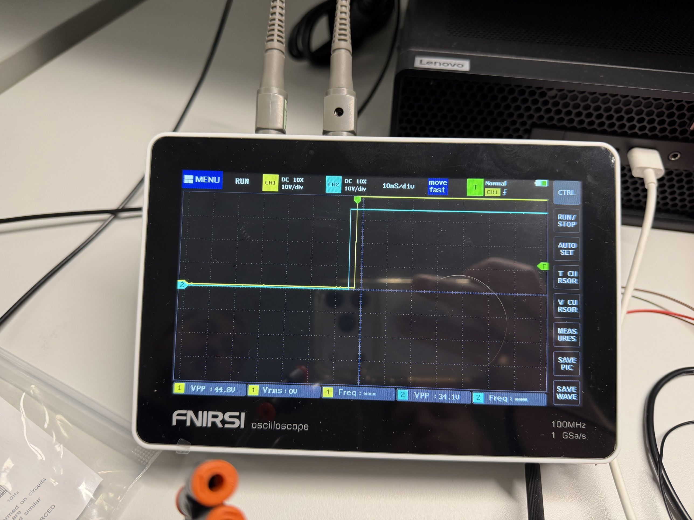 | 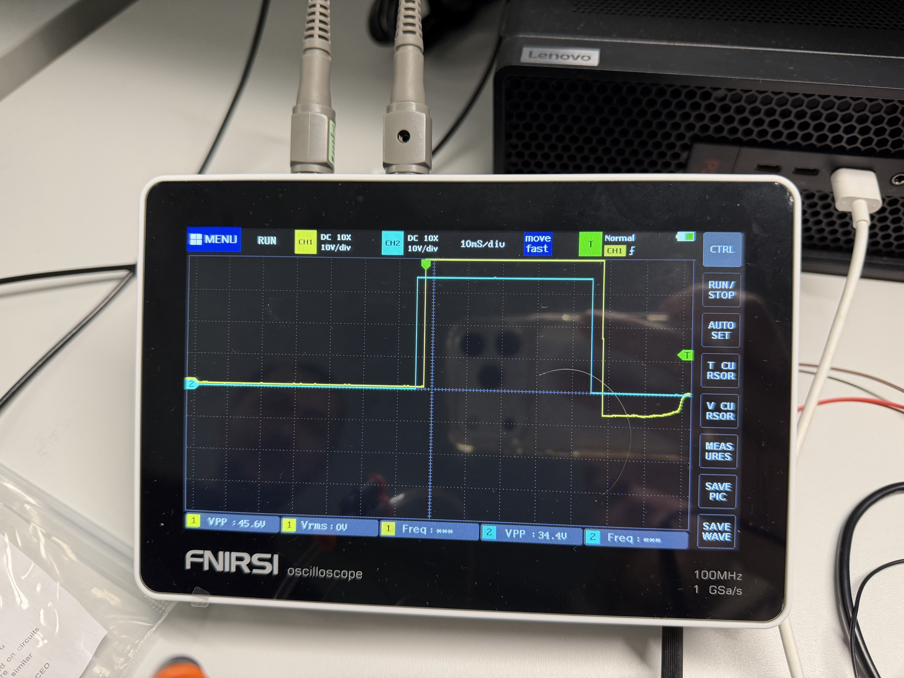 |

- **Probi seadistus vale:** menüüs 10X, probid ise 1X → kõik pinged näitavad 10× liiga palju (G22 Vpp "34,1 V" = tegelikult 3,4 V). Kollane (24 V → "240 V") läheb ekraanilt üles välja, Vpp 45 V on lõigatud. KAARDISTA ISE: menüü 1X (või probi lüliti 10X) ja pildista uuesti.
- Ajad (50 ms impulss, mõõdupuu türkiis = 50 ms, ≈ 14 jaotist):
  - G22 ↑ → mähisel 24 V: ≈ 1,9 ms; G22 ↓ → mähis vooluta: ≈ 3,0 ms → sama mis releel üksi.
  - **Uus:** pärast relee avanemist läheb mähise pinge **alla nulli** (≈ −0,9 V, arvestades 10× viga) ja püsib seal **≈ 23 ms**, siis tõuseb nulli. See on kaitsediood töös: mähise vool jookseb dioodi kaudu ringi ja kustub aeglaselt (L/R). Ülespiiki ei ole — diood töötab.
  - Tähendus: mähise magnetväli ei kao relee avanemisel, vaid ≈ 23 ms jooksul. Klapp võib sulguda alles selle aja sees → **tilk võib olla pikem kui impulss**. KAARDISTA ISE: kui palju, näitab rõhukõver (osa 2).

**Klapi sisselülitus, 2 ms/div** (CH1 probi lüliti nüüd 10X = õige; CH2 probi lüliti veel 1X, menüü 10X → türkiis näitab 10× liiga palju):

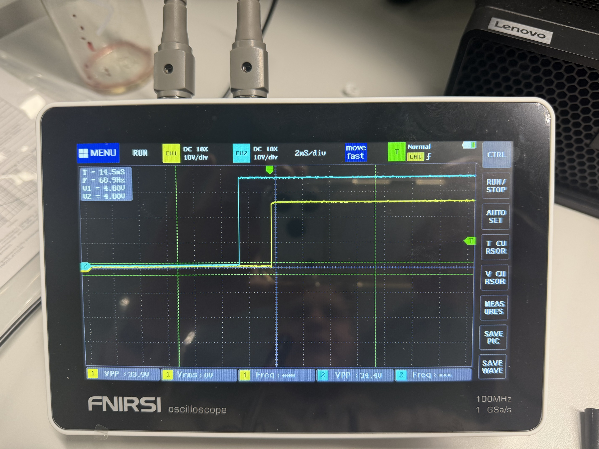

- T CURSOR kahe joone vahe 14,5 ms = 661 px → 45,6 px/ms, 2 ms/div = 91 px → ekraanil **14 jaotist** (kinnitab varasemat).
- G22 ↑ → mähisel 24 V (Vpp 33,9 V, nivoo ≈ 2,6 jaotist ≈ 25 V): **≈ 2,4 ms** (108 px). Sama mis relee üksi (≈ 2,3–2,4 ms) → klapp koormusena relee viivitust ei muuda.
- KAARDISTA ISE: T CURSOR otse kahe esifrondi peale → täpne arv; CH2 probi lüliti 10X.

Sama, mõlemad probid nüüd 10X (menüü ja lüliti kokku): türkiis G22 ≈ 0,35 jaotist ≈ 3,4 V, kollane Vpp 25,8 V — pinged õiged.

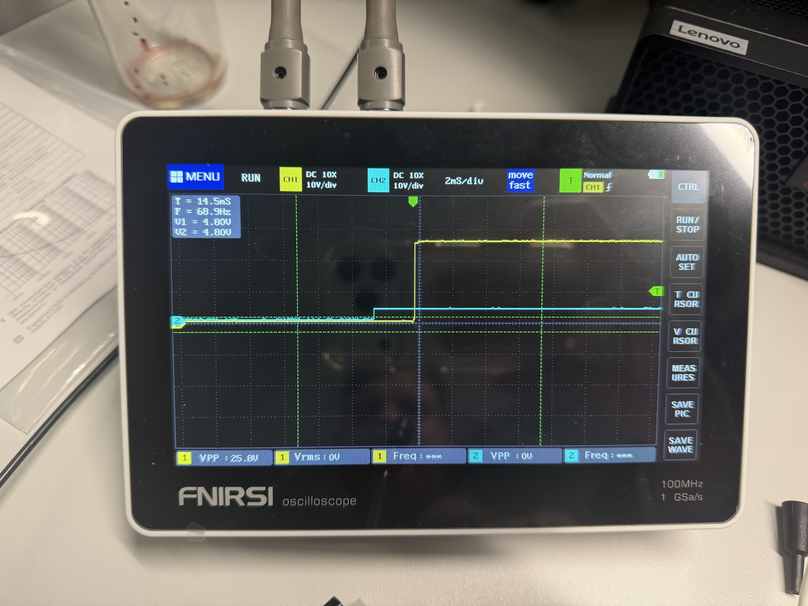

- T CURSOR 14,5 ms = 608 px → 41,9 px/ms; frontide vahe 100 px → **≈ 2,4 ms**. Kordub → klapi sisselülituse viivitus (käsk → 24 V mähisel) ≈ 2,4 ms.

**Klapi impulsid, probid lõpuks õiged** (CH1 10X 10 V/div, CH2 1X 1 V/div):

| Sisse 2 ms/div | 20 ms | 50 ms | 100 ms |
| :---: | :---: | :---: | :---: |
| 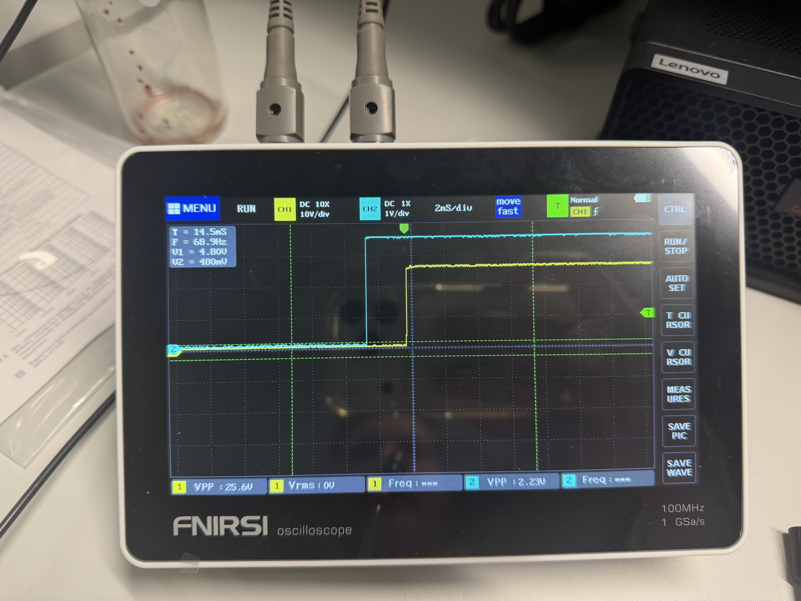 | 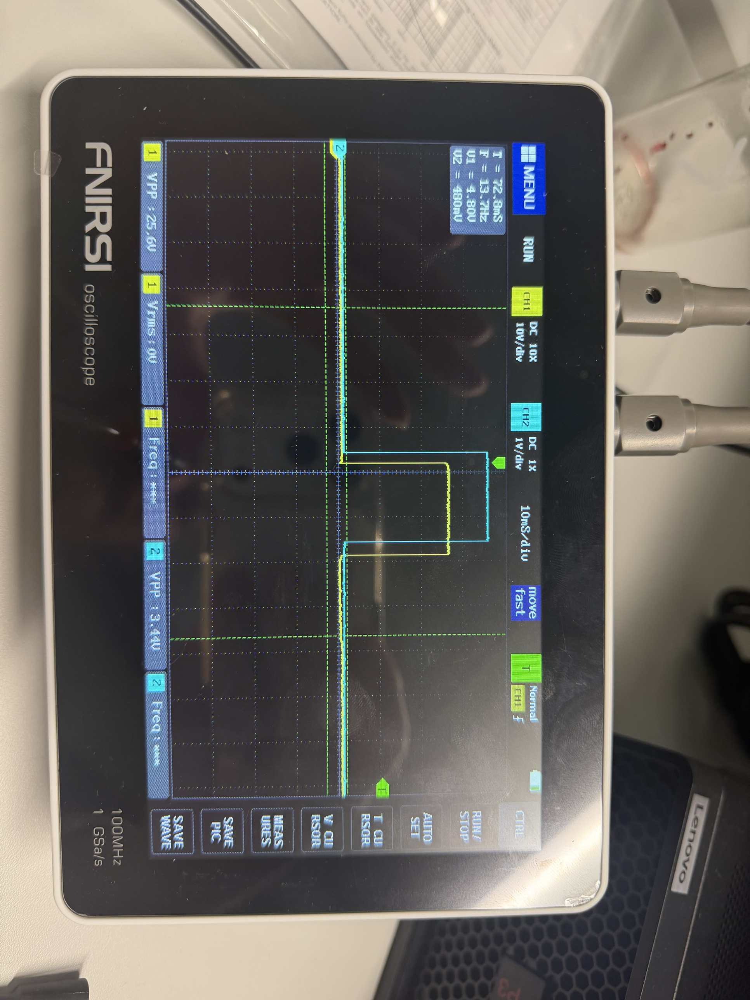 | 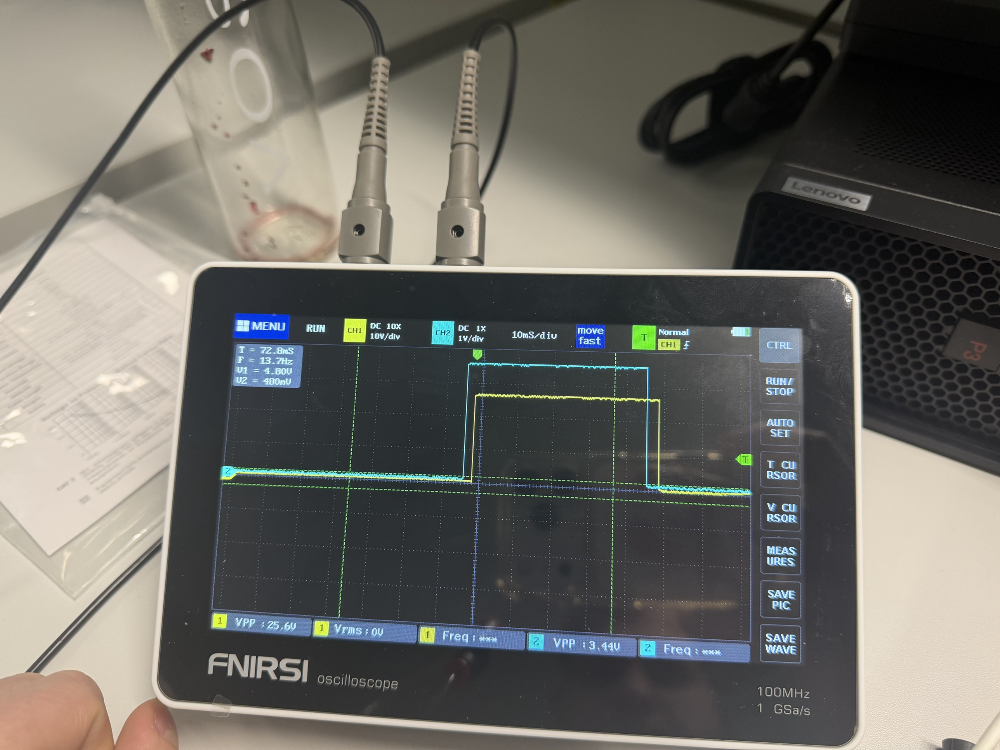 | 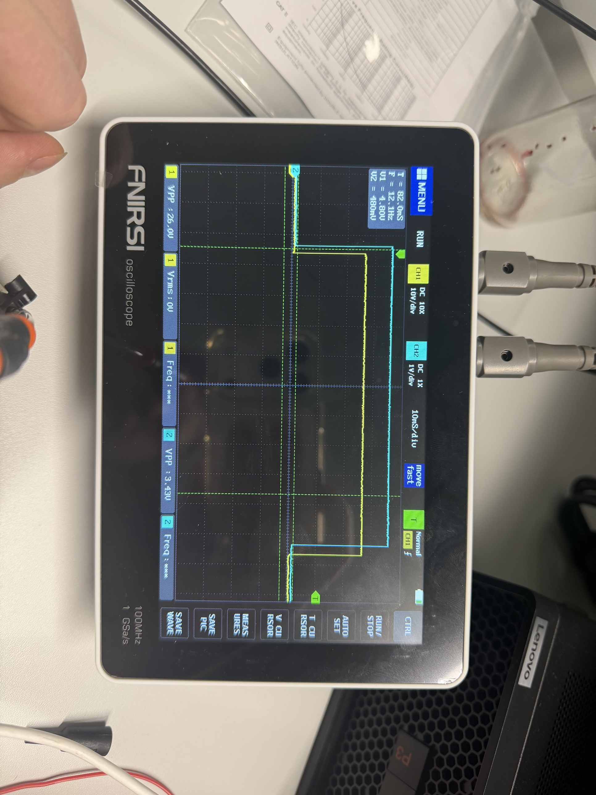 |

Fotolt, mõõdupuuks T CURSOR-i lugem (pöördfotod on 90° keeratud):

| Käsk | Mähisel 24 V | Algus G22 järel | Lõpp G22 järel |
| ---: | ---: | ---: | ---: |
| sisse (2 ms/div) | — | **≈ 2,5 ms** | — |
| 20 ms | ≈ 20,5 ms | ≈ 2,2 ms | ≈ 2,7 ms |
| 50 ms | ≈ 50,8 ms | ≈ 1,8 ms | ≈ 3,2 ms |
| 100 ms | ≈ 100 ms | ≈ 2,0 ms | ≈ 2,6 ms |

- 10 ms/div fotolt on täpsus ≈ ±0,5 ms; 2 ms/div ≈ ±0,1 ms.
- Kokku: mähis saab pinge ≈ 2,4 ms pärast käsku ja kaotab ≈ 2,8 ms pärast käsu lõppu → pinge mähisel ≈ käsk + 0,5 ms. Sama mis relee üksi — klapp relee aegu ei muuda.
- Dioodi "saba" (≈ −0,9 V) 10 V/div peal ei paista (0,09 jaotist). KAARDISTA ISE: väljalülitus CH1 1 V/div, trigger CH2 ↓, T CURSOR saba pikkusele.

**Klapi väljalülitus, 5 ms/div** (trigger CH2 ↓):

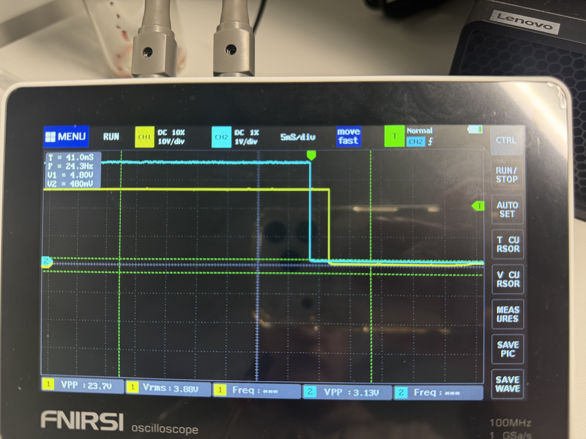

- T CURSOR 41,0 ms = 855 px → 20,9 px/ms; G22 ↓ → mähis 0 V: 65 px → **≈ 3,1 ms**.
- CH1 oli veel 10 V/div → dioodi saba jälle ei paista. KAARDISTA ISE: sama pilt CH1 1 V/div peal.

Relee üksi (koormus NO → 1 kΩ → GND), klappi veel ei ole. G22 = `len_us` logist [`data/pulse_log_2.csv`](data/pulse_log_2.csv), 5 impulsi keskmine; NO ja viivitused ostsilloskoobilt.

| Käsk, ms | G22 (Atom), ms | G22 hajuvus, µs | NO (relee kontakt), ms | Viivitus sisse, ms | Viivitus välja, ms | Põrge, ms | Klapi mähis, ms |
| ---: | ---: | ---: | ---: | ---: | ---: | ---: | ---: |
| 20 | 20,092 | 15 | ≈ 20,8 (foto) | ≈ 2,3 | ≈ 3,0 | ≈ 0,4 sisse, välja 0 | ≈ 20,5 (+2,2 / +2,7) |
| 50 | 50,089 | 5 | ≈ 50,5 (foto) | ≈ 2,4 | ≈ 2,9 | | ≈ 50,8 (+1,8 / +3,2) |
| 100 | 100,089 | 4 | ≈ 100,7 (arvutatud) | | | | ≈ 100 (+2,0 / +2,6) |
| 200 | 200,093 | 8 | ≈ 200,7 (arvutatud) | | | | KAARDISTA ISE |
| 500 | 500,090 | 6 | ≈ 500,7 (arvutatud) | | | | KAARDISTA ISE |

- **Atom:** impulss G22-l on ≈ **0,09 ms pikem** kui käsk, hajuvus ≤ 15 µs. Esimene impulss on 20,289 ms (MicroPython käivitab koodi esimest korda) → see on keskmisest välja jäetud.
- **Relee:** viivitused ei sõltu impulsi pikkusest (20 ja 50 ms sama), seega NO = G22 + (välja − sisse) ≈ G22 + 0,6 ms. 100–500 ms read on arvutatud, mitte mõõdetud.
- **Kokku:** kontakt on kinni ≈ käsk + 0,7 ms, ≈ 2,4 ms hiljem kui käsk. 20 ms juures ≈ 3,5 % viga, 500 ms juures ≈ 0,1 %.

**Relee:** Relay Unit sees on Huike **HK4100F-DC5V-SHG** (mähis 5 V, 200 mW, 1 ümberlülituskontakt, 3 A @ 30 V DC). Andmelehelt ([LCSC C12072](https://www.lcsc.com/datasheet/lcsc_datasheet_2304140030_Ningbo-Keke-New-Era-Appliance-HK4100F-DC5V-SHG_C12072.pdf)):

| Parameeter | Andmeleht | Mõõdetud |
| :--- | :--- | :--- |
| Sisselülitusaeg | ≤ 6 ms (osa allikaid: 10 ms) | ≈ 2,4 ms (esimene puude ≈ 2,0–2,3 ms) |
| Põrge sisselülitusel | — | ≈ 0,4 ms, 2 hüpet |
| Väljalülitusaeg | ≤ 4–5 ms (kontrolli) | ≈ 2,9–3,1 ms, põrget ei ole |
| Elektriline eluiga | ≥ 100 000 lülitust (3 A, 30 lülitust/min) | — |
| Mehaaniline eluiga | ≥ 10 000 000 lülitust | — |

**Relee eluiga tilkades.** Üks tilk = üks lülitus (sisse + välja). Andmeleht lubab koormusega vähemalt 100 000 lülitust, kuni 30 lülitust minutis.
- Selle labori katsed: osa 2 (≥ 5 × 10 tilka), osa 3–4 kõverad, testid ja kaitsmine kokku umbes **500–1000 lülitust** → alla 1 % elueast.
- Tootmise näide (eeldus, mitte mõõdetud): üks tilk iga klaasi kohta, roboti tsükkel ≈ 30 s → 2 tilka/min, 8 h päevas ≈ **960 tilka/päev** → 100 000 / 960 ≈ **104 tööpäeva**, ehk umbes 5 kuud ühes vahetuses. 2 tilka/min on 30 lülitust/min piirist kaugel all.
- Meie koormus on 0,037 A ehk ≈ 1 % nimivoolust 3 A, kontaktid kuluvad vähem ja tegelik eluiga on tõenäoliselt suurem (ülemine piir 10 000 000 mehaanilist lülitust). Andmeleht garanteerib aga ainult 100 000, nii et hoolduse planeerimiseks võtame selle.
- Järeldus: relee ei ole selles töös piirav osa. Kui toode peaks aastaid käima, oleks parem pooljuhtlüliti (MOSFET või SSR): põrget ei ole, viivitus µs, kulumist ei ole.

**Anduri koht voolikus ja miks.** Rõhuandur (MPX5700AP Laborist 1–2) on **klapi ja süstla vahel**, T-liitmikuga klapi pordi 2 ja süstla vahel, süstlale võimalikult lähedal:

```
pump ──► klapp port 3        port 2 ──┬──► süstal ──► otsik ──► tilk
                port 1 → õhku         └──► rõhuandur
```

Miks just seal:
- Andur näeb **süstla rõhku** ehk seda, mis tilka tegelikult välja surub. Pumba poolel (enne klappi) näeks ta ainult pumba rõhku, mis on olemas ka siis, kui klapp on kinni, ja tilgast ei ütleks see midagi.
- Klapi avanemine ja sulgumine on rõhukõveral näha: klapp lahti → rõhk tõuseb, klapp kinni → süstal läheb pordi 1 kaudu õhku ja rõhk langeb. Nii saab mõõta, millal klapp **mehaaniliselt** avanes ja sulgus. Ostsilloskoop näitab ainult mähise pinget, mitte seda (vt dioodi saba).
- Rikked on samas kohas nähtavad (oodatav, kontrollime osas 3):
  - **kinnine otsik:** õhk ei pääse süstlast välja → rõhk tõuseb kiiresti pumba rõhuni ja jääb sinna;
  - **tühi süstal:** vaigu asemel läheb otsikust õhk → rõhk tõuseb vähem ja/või langeb kiiremini;
  - **tavaline tilk:** rõhk tõuseb ja langeb vahepealse kiirusega.
  Just dP/dt (muutumise kiirus) eristab neid, ja selle järgi lülitub osas 4 katkestus.
- Süstlale lähedal, et T ja anduri vahel oleks vähe õhku: väiksem surnud ruumala → kiirem ja teravam rõhukõver.
- Otse süstla otsikusse andurit panna ei saa: seal on vaik, mitte õhk.

#### Osa 1 kokkuvõte

- **Ahel:** Atom G26 → Grove → M5Stack Mini 3A Relay Unit (HK4100F) → COM/NO → klapp 24 V (3/2 NC, 0,037 A, kaitsediood mähisel) → labori-BP 24 V. Atomi ja klapi ahel on releega eraldatud; ühine maa ainult ostsilloskoobi jaoks.
- **Impulss:** riistvarataimer (`machine.Timer`, ONE_SHOT). Atomi viigul on impulss käsk + 0,09 ms, hajuvus ≤ 15 µs. Esimene impulss pärast käivitust ≈ 0,2 ms pikem.
- **Relee/klapi mähis:** pinge mähisel tuleb ≈ 2,4 ms pärast käsku ja kaob ≈ 2,9–3,1 ms pärast käsu lõppu → mähis saab pinget ≈ käsk + 0,5 ms, nihutatud ≈ 2,4 ms hilisemaks. 20 ms tilga juures on see ≈ 2,5 % viga, 500 ms juures ≈ 0,1 %.
- **Põrge:** ainult sisselülitusel, ≈ 0,4 ms; klapile vahet ei ole (mähis ei jõua 0,4 ms-ga vabastada), aga katkestuse sisendile oleks (vt osa 4: hüsterees).
- **Diood:** kaitseb releed (ülespiiki ei ole), aga mähise vool kustub läbi dioodi aeglaselt → klapp võib sulguda hiljem kui 3 ms. Kui palju, näitab rõhukõver osas 2.
- **Atomi ajastus ei sõltu** 24 V-st ega klapi voolust (BP väljas/sees vahe ≤ 2 µs).
- **Mis jäi lahti:** skeemi foto, dioodi saba pikkus (CH1 1 V/div), klapi mehaaniline viivitus rõhukõveralt.

### 2. Tilga suurus

**Tulemus:** KAARDISTA ISE (graafik + lühike järeldus). Retsept: [`docs/recipe.md`](docs/recipe.md)

### 3. Filter ja tuletis

| Filter | Parameetrid | dP/dt müra (std), kPa/s | Viivitus, ms |
| :--- | :--- | ---: | ---: |
| toores | — | | 0 |
| | | | |
| | | | |

**Valitud filter ja miks:** KAARDISTA ISE

**Katkestuse tunnus (lävi, hüsterees):** KAARDISTA ISE

### 4. Katkestus

**Falstad:** KAARDISTA ISE (pilt + link). Mõõdetud reageerimise ajad: [`docs/latency.csv`](docs/latency.csv)

| Olukord | Alarm? | Reageerimine IRQ-ga, ms | Ilma IRQ-ta, ms |
| :--- | :--- | ---: | ---: |
| tavaline tilk | | | |
| kinnine otsik | | | |
| tühi süstal | | | |

---

## Arenduspäevik

Midagi ei kustutata. Vale number jääb, kuupäevaga, parandus tuleb tema alla.

### 13.11.2026

Lab3 kaust ja tööplaan tehtud.

Atom Lite + M5Stack Mini 3A Relay Unit Grove-kaabliga (G26). `src/relay_test.py`: relee klõpsub, töötab. Käivitus: `python -m mpremote connect COM5 run relay_test.py`.

Relay Unit klemmid (silt): vasak = COM, keskmine = NO, parem = NC. Klapp läheb COM–NO vahele: vooluta on kontakt lahti, klapp vooluta, süstal õhku.

`src/pulse.py` (riistvarataimer, 20/50/100/200/500 ms × 5) jooksis läbi, relee klõpsus, logis samm = impulss + ~1000,3 ms. Ostsilloskoobil ei olnud midagi näha.

Multimeetriga (`src/hold.py`): G22 ON = **4,7 V**, OFF = 0,1 V; COM 4,9 V; NO 4,9 V. GPIO ei saa anda üle 3,3 V → Atomi 3,3 V siin on tõenäoliselt ~5 V peal (regulaator läbi või 5 V sattus 3V3 / GPIO viigule). Õppejõu hinnang: Atom on tõenäoliselt läbi põlenud. KAARDISTA ISE: 3V3 viigu pinge, mis täpselt juhtus, uus Atom.

**Parandus:** 3V3 viik = 3,3 V, G22 ilma ostsilloskoobi probita: ON 3,3 V, OFF 0,1 V. Atom on terve. 4,7 V tuli sellest, et probide maa-krokodillid ei olnud GND küljes (FNIRSI 1013D: CH1 ja CH2 maa on sees ühendatud). Nüüd mõlemad krokodillid ainult Atomi GND-l.

Esimene ostsilloskoobi pilt (FNIRSI 1013D, 1 ms/div, CH1 2,5 V/div kollane = relee kontakt, CH2 1 V/div türkiis = G22 käsk, trigger Normal CH1):

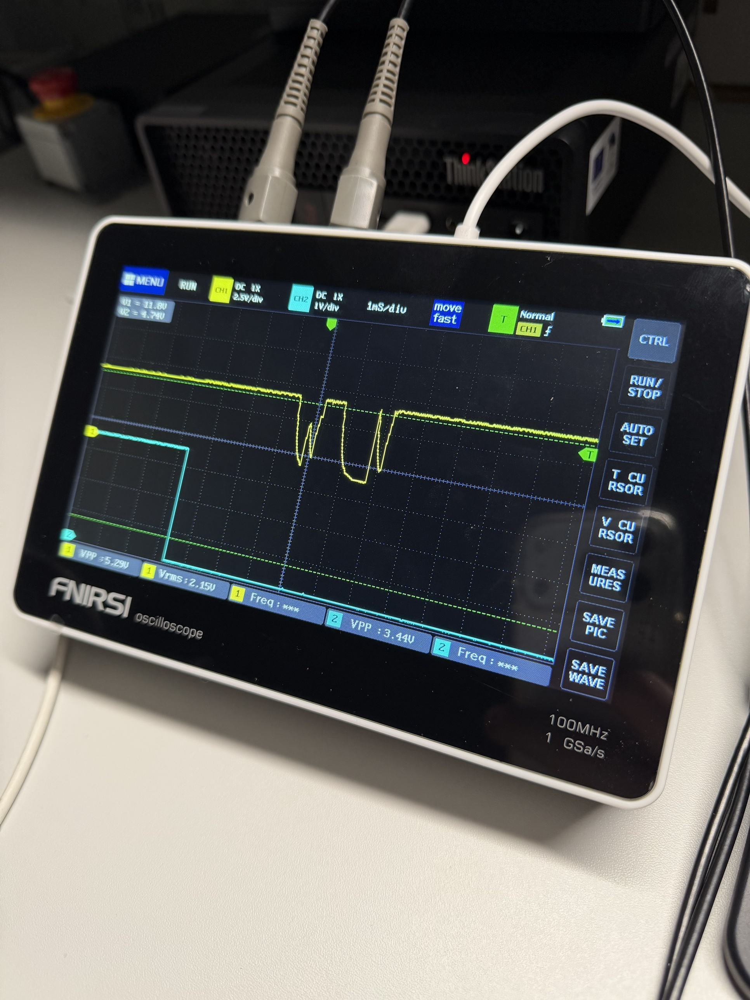

- Türkiis (G22, Vpp 3,44 V) läheb alla = Atom käsib relee välja.
- Kollane (relee kontakt, Vpp 5,29 V) hakkab liikuma umbes **2,7–3 ms** hiljem: see on relee **väljalülitusviivitus** (andmeleht ≤ 4–5 ms).
- Kontakt põrkab umbes **2 ms** (mitu hüpet).
- Atom ei ole "kiirem": käsk tuleb enne, relee jääb ~3 ms maha. See on mehaanika.
- **Lahtine küsimus:** pärast põrget läheb kollane tagasi üles. NO → 1 kΩ → GND puhul peaks ta väljalülitusel jääma 0 V peale. KAARDISTA ISE: kontrolli, mis klemmi peal kollane prob on, ja pildista ka sisselülitus (trigger CH2 rising).

500 ms impulss, 1 ms/div (silma järgi, täpsemalt T CURSOR-iga):

| Väljalülitus | Sisselülitus |
| :---: | :---: |
| 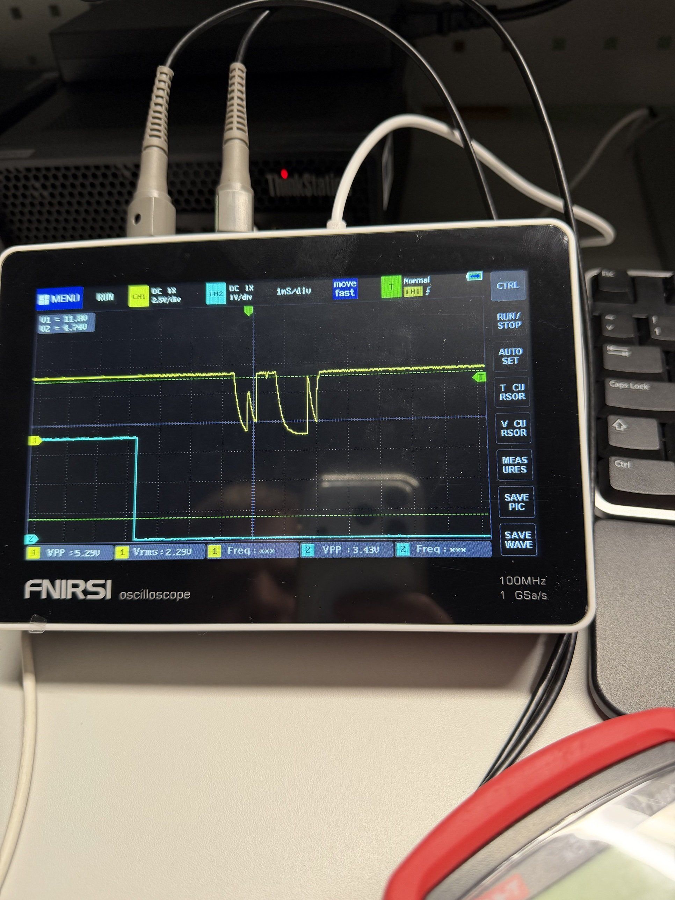 | 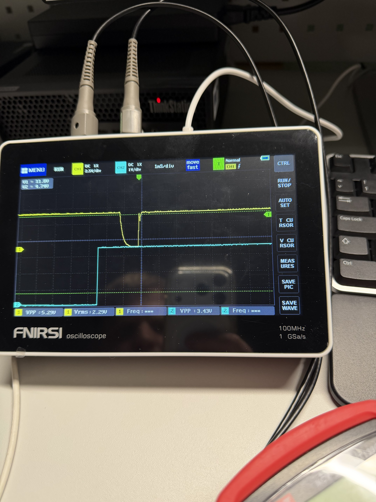 |

| | Käsk → kontakt hakkab liikuma | Käsk → kontakt rahunenud |
| :--- | ---: | ---: |
| Sisse (CH2 üles) | ≈ 1,1 ms | ≈ 2,0 ms |
| Välja (CH2 alla) | ≈ 2,6 ms | ≈ 4,8 ms (≈ 2,2 ms põrget) |

- Mõlemad alla andmelehe piiri (sisse ≤ 6 ms, välja ≤ 4–5 ms). Välja on aeglasem kui sisse.
- **Kollane on üleval mõlemas olekus** ja kukub alla ainult siis, kui ankur liigub. Sisselülitusel langeb ta sujuvalt (≈ 0,4 ms), mitte järsult: see sõlm on liikumise ajal "õhus" ja tühjeneb läbi ostsilloskoobi 1 MΩ sisendi. Tähendab: kollane prob ei mõõda NO → 1 kΩ → GND, nagu plaanitud. Kas 1 kΩ ei ole GND-ga ühendatud või on 5 V mõlemal pool kontakti. KAARDISTA ISE: multimeetriga kõik kolm klemmi ON/OFF, takisti otsad GND vastu.
- Mida see siiski näitab: kui kaua ankur liigub ühelt kontaktilt teisele.

**Põhjus leitud:** 1 kΩ takisti oli **NO ja NC vahel**, mitte NO ja GND vahel. COM = 5 V, nii et:
- OFF: COM–NC kinni → NC = 5 V → läbi takisti NO = 5 V (vool ei käi, takistil pinget ei kao);
- ON: COM–NO kinni → NO = 5 V otse;
- ankur liigub: kumbki ei ole COM-iga ühenduses → sõlm on õhus ja tühjeneb läbi ostsilloskoobi 1 MΩ → sujuv langus ja põrked.

Parandus: takisti NO → GND, NC tühi. Mõõtmised tuleb uuesti teha.

**Õige ühendusega, sisselülitus** (500 ms impulss, 500 µs/div, CH1 kollane = NO 2,5 V/div, CH2 türkiis = G22 1 V/div, trigger Normal CH1 ↑):

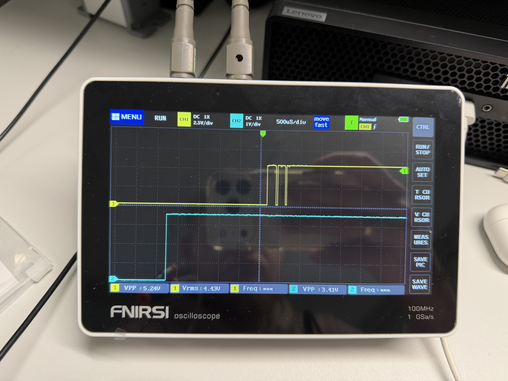

- Nüüd on kollane OFF ajal 0 V ja ON ajal 5 V (Vpp 5,24 V) — nii, nagu peab.
- G22 üles → NO esimest korda üles: **≈ 2,0 ms** (≈ 4,1 jaotist × 500 µs).
- Kontakt põrkab 2 korda, põrge kestab **≈ 0,4 ms**; G22 → NO lõplikult üleval **≈ 2,5 ms**.
- Andmeleht: sisselülitus ≤ 6 ms → mahub sisse.
- Eelmised "sisse ≈ 1,1 / 2,0 ms" olid vale ühendusega (näitasid NC-lt lahtitulekut) — need ei kehti.
- KAARDISTA ISE: väljalülitus sama ühendusega, ja kõik 5 impulsi pikkust.

**Õige ühendusega, väljalülitus** (500 ms impulss, 1 ms/div, trigger Normal **CH2 ↓**):

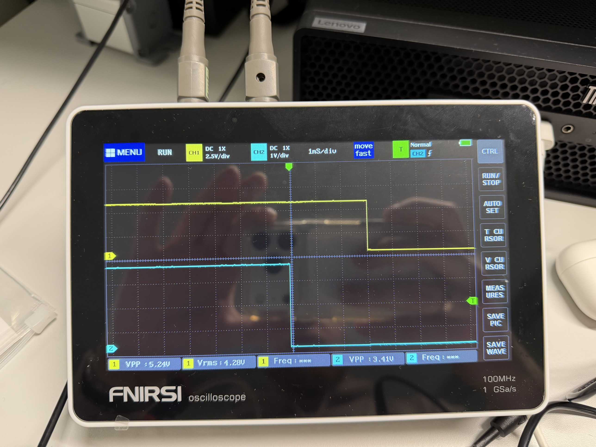

- G22 alla → NO alla: **≈ 2,5 ms** (≈ 2,5 jaotist × 1 ms). Andmeleht ≤ 4–5 ms → mahub sisse.
- Väljalülitusel **põrget ei ole näha**: kontakt läheb lahti ühe korraga. Põrge on ainult sulgemisel, kui kontakt vastu teist lööb.
- Eelmised "välja ≈ 2,6 / 4,8 ms, 2,2 ms põrget" olid vale ühendusega — ei kehti.

**Kokkuvõte, relee üksi (500 ms):**

| | Käsk → esimene kontakt | Käsk → kontakt rahunenud | Põrge |
| :--- | ---: | ---: | ---: |
| Sisse | ≈ 2,0 ms | ≈ 2,5 ms | ≈ 0,4 ms |
| Välja | ≈ 2,5 ms | ≈ 2,5 ms | ei ole |

Mõlemad viivitused on umbes ühesugused, nii et kontakt on kinni umbes sama kaua kui käsk (500 ms käsk → kontakt ≈ 500,5 ms esimesest puutest, ≈ 500 ms rahunemisest), aga ≈ 2–2,5 ms hiljem. KAARDISTA ISE: kas see kehtib ka 20 ms impulsil, ja kas klapp lisab oma viivituse.

**Logi `data/pulse_log_1.csv`** (`pulse.py`, ainult `t_on`): kahe impulsi vahe miinus (käsk + 1000 ms paus):

| Käsk, ms | Lisa ühe tsükli kohta, µs (keskmine) | Hajuvus (max−min), µs |
| ---: | ---: | ---: |
| 20 | 284 (esimene 581) | 17 (ilma esimeseta) |
| 50 | 273 | 14 |
| 100 | 297 | 13 |
| 200 | 302 | 15 |
| 500 | 294 | 9 |

- Taimer on stabiilne: hajuvus ≤ 17 µs, ei sõltu impulsi pikkusest.
- ~0,3 ms lisa on impulss + `print` + tsükkel kokku — sellest ei saa eraldi välja lugeda, kui pikk oli impulss G22-l. Esimene tsükkel on aeglasem (581 µs), sest MicroPython käivitab koodi esimest korda.
- NO pikkust logist ei saa: Atom ei mõõda kontakti. NO ainult ostsilloskoobiga.
- `pulse.py` uuendatud: logib nüüd ka `t_off` ja `len_us` (impulsi pikkus Atomi kellaga).

**20 ms impulss tervikuna** (10 ms/div, mõlemad kanalid 2,5 V/div, nullid kohakuti, trigger Normal CH1 ↑):

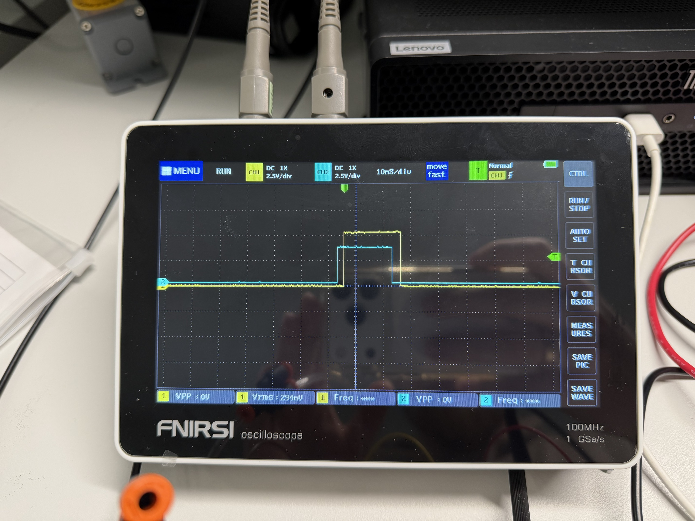

Fotolt, mõõdupuuks türkiis = 20 ms (Atomi taimer):

| | Pikkus | Viivitus G22 suhtes |
| :--- | ---: | ---: |
| G22 (türkiis) | 20 ms (mõõdupuu) | — |
| NO (kollane) | ≈ 20,8 ms | sisse ≈ 2,3 ms, välja ≈ 3,0 ms |

- Kollane algab ≈ 2,3 ms hiljem ja lõpeb ≈ 3,0 ms hiljem → kontakt on kinni ≈ **0,7 ms kauem** kui käsk (täpsus fotolt ≈ ±0,3 ms).
- 20 ms impulsi juures on see ≈ 3,5 % viga; 500 ms juures ≈ 0,1 %.
**50 ms impulss** (10 ms/div, sama seadistus):

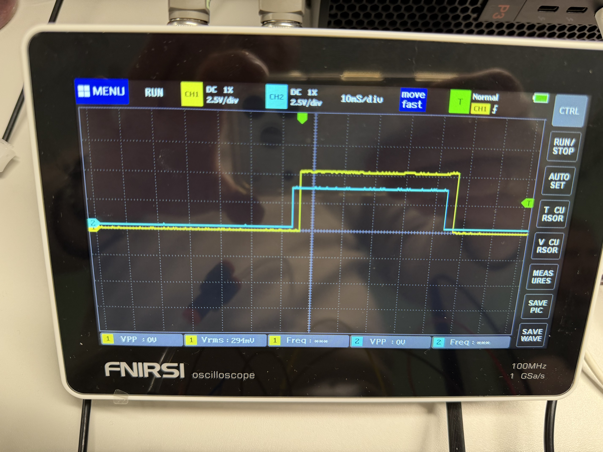

| | Pikkus | Viivitus G22 suhtes |
| :--- | ---: | ---: |
| G22 (türkiis) | 50 ms (mõõdupuu) | — |
| NO (kollane) | ≈ 50,5 ms | sisse ≈ 2,4 ms, välja ≈ 2,9 ms |

- Sama pilt mis 20 ms juures: kontakt ≈ 0,5–0,7 ms kauem kinni, ≈ 2,4 ms hiljem. Viivitused ei sõltu impulsi pikkusest.
- Selle pildi järgi on ekraanil **≈ 14 jaotist** (10 ms = ≈ 103 px, ruudustik ≈ 1460 px). Seega 12 jaotise eeldusel loetud vanad numbrid (2,0 / 2,5 ms) on ≈ 15 % liiga väikesed; õiged on ≈ 2,3–2,4 / 2,9–3,0 ms.
- Ostsilloskoop ei näita üle 10 ms/div midagi → pikemate impulsside NO pikkus arvutatakse: `NO = len_us (G22) + (välja viivitus − sisse viivitus)`, viivitused 1 ms/div-ga iga pikkuse jaoks.
- **Hoiatus eelmiste numbrite kohta:** viivitused (≈ 2,0 / 2,5 ms) on loetud fotolt eeldusel, et ekraanil on 12 jaotist. Kui võtta türkiis = 20 ms mõõdupuuks, tuleb jaotisi rohkem (~14) ja viivitused võivad olla ≈ 15–20 % suuremad (≈ 2,4 / 2,9 ms). KAARDISTA ISE: loe ekraani jaotised kokku ja mõõda viivitused **T CURSOR**-iga, mitte fotolt.
- `pulse.py` uuesti (logib `len_us`, taimer nullitakse alguses, kaitse rippuva taimeri vastu): [`data/pulse_log_2.csv`](data/pulse_log_2.csv). G22 impulss = käsk + 87–97 µs kõigil pikkustel; esimene 20 ms impulss 20,289 ms. Tabel osas 1 täidetud.
- FNIRSI 1013D-l on tavarežiimis suurim 50 ms/div (100 ms juures läheb roll-režiimi). 500 ms impulss → 50 ms/div.
