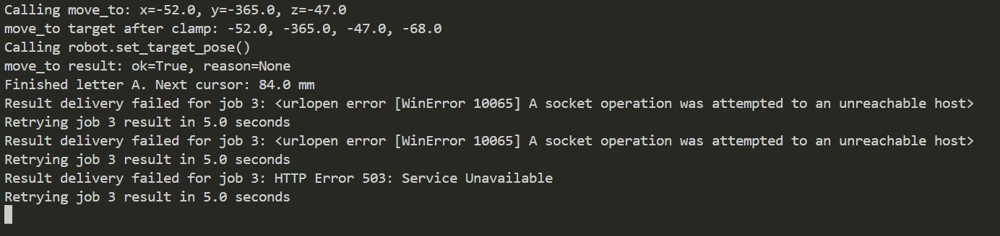

## Videokatsete tulemuste kokkuvõte

[Vaata ühenduse katkestamise videot (MP4)](uhenduse_katkestamine.mp4)

Video filmitud 25.10

Videos on näha, et robotile antakse töö kirjutada tähte - staatus on "send". Seejärel katkestatakse roboti ühendus. Vaatamata sellele lõpetab robot oma töö ära. Ühenduse taasloomisel on näha, et staatus on "Done".

Logi:
